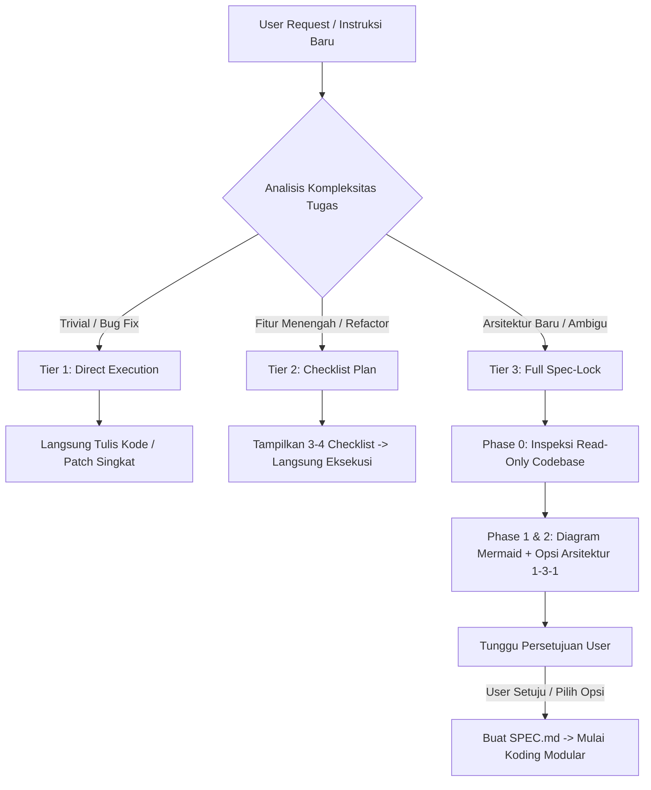

# Universal Spec-First Architect Skill (v2.0.0)

[](https://opensource.org/licenses/MIT)
[](https://github.com/Develean/universal-spec-first-architect)
[]()

**Universal Spec-First Architect** adalah protokol rekayasa perangkat lunak adaptif lintas AI Agent yang dirancang untuk mencegah AI langsung menulis kode secara membabi buta (*blind execution* / *code drift*). 

Protokol ini memaksa AI memahami arsitektur, memeriksa kodebase yang ada, memvisualisasikan alur sistem lewat diagram Mermaid, dan membuat kontrak spesifikasi yang disetujui bersama sebelum memodifikasi berkas penting.

---

## Fitur Utama

1. **3-Tier Complexity Triage (Adaptif & Hemat Token):**
   * **Tier 1 (Trivial):** Langsung eksekusi tanpa birokrasi, tanpa kunci (*lock*), dan tanpa diagram.
   * **Tier 2 (Fitur Menengah):** Susun rencana ringkas (3-4 langkah *checklist*), lalu langsung eksekusi.
   * **Tier 3 (Arsitektur Besar / Sistem Baru):** Kunci eksekusi penuh (*Full Spec-Lock*), buat diagram Mermaid, tawarkan 2-3 strategi arsitektur (1-3-1 Rule), dan tunggu persetujuan pengguna.
2. **Phase 0: Grounding & Context Discovery (Bebas Halusinasi):**
   * AI diwajibkan memeriksa *stack*, skema, dan konfigurasi repo terlebih dahulu menggunakan perintah *read-only* (`read_file`, `grep`, `git status`) sebelum mengusulkan arsitektur.
3. **Standarisasi Kontrak Eksekusi (`SPEC_TEMPLATE.md`):**
   * Dilengkapi template kontrak kerja yang memuat batasan tegas: *In-Scope*, *Non-Scope* (mencegah *scope creep*), *Checklist*, dan *Definition of Done (DoD)*.
4. **Gaya Komunikasi Natural & Fleksibel:**
   * AI secara dinamis menyesuaikan gaya bahasa, tingkat keformalan, dan dialek pengguna tanpa memaksakan sapaan kaku.

---

## Panduan Penggunaan (Workflow Harian)

Setelah protokol ini terpasang di proyek atau lingkungan Anda, **Anda tidak perlu menghafal perintah rumit**. Cukup ajak AI berbicara seperti biasa. AI akan secara otomatis mengklasifikasikan tugas Anda ke dalam 3 tingkatan (Tier):



### 1. Skenario Tier 1: Tugas Cepat / Bug Fix (Zero Lock)
Gunakan untuk tugas-tugas kecil yang sudah sangat jelas batasannya.

* **Contoh Perintah Pengguna:**
  > *"Perbaiki typo di variabel `userEmial` pada file `src/auth.ts` line 42."*  
  > *"Ganti warna tombol submit di `Navbar.vue` menjadi warna biru indigo."*
* **Respon AI:**
  AI langsung membuka file dan melakukan perbaikan tanpa bertanya, tanpa menggambar diagram, dan tanpa mengunci percakapan.

---

### 2. Skenario Tier 2: Fitur Menengah / Refactor Terstruktur
Gunakan untuk penambahan komponen atau refactoring yang menyentuh beberapa file tetapi polanya sudah ada.

* **Contoh Perintah Pengguna:**
  > *"Tambahkan endpoint baru `GET /api/v1/orders/history` lengkap dengan pagination dan filter status di backend Express ini."*
* **Respon AI:**
  AI akan langsung menampilkan rencana 3-4 langkah, lalu mengeksekusinya:
  > *Rencana Eksekusi:*
  > 1. *Tambahkan query function di `repositories/orderRepository.ts`.*
  > 2. *Buat controller handler di `controllers/orderController.ts` untuk memproses pagination.*
  > 3. *Daftarkan route baru di `routes/orderRoutes.ts`.*
  > 
  > *(AI langsung mengedit file-file tersebut secara teratur).*

---

### 3. Skenario Tier 3: Sistem Baru / Arsitektur Kompleks (Full Lock)
Gunakan saat Anda memulai fitur besar, modul pembayaran, autentikasi, integrasi pihak ketiga, atau ide yang masih abstrak.

* **Langkah 1: Pengguna Memberikan Tugas Kompleks**
  > *"Saya mau bikin sistem presensi digital dengan deteksi lokasi GPS dan deteksi wajah anti-fake GPS untuk sekolah."*

* **Langkah 2: AI Mengunci Eksekusi & Menyajikan Rancangan Visual**
  AI akan menjalankan **Phase 0 (Inspeksi)**, lalu merespon dengan:
  ```markdown
  [EXECUTION LOCKED] Sebelum mulai koding, berikut arsitektur dan alur yang diusulkan:

  ### Visual Flow
  ```mermaid
  flowchart TD
      A[Mobile Client] -->|Kirim Koordinat + Foto| B[API Gateway]
      B --> C{Geofencing Validator}
      C -->|Di Luar Radius| D[Tolak Presensi]
      C -->|Di Dalam Radius| E[Face Verification Service]
      E --> F[(Database Presensi)]
  ```

  ### Pilihan Arsitektur & Rekomendasi (1-3-1)
  - **Opsi A: Client-side Geofencing + Server Verification (Recommended)**
    - *Kelebihan:* Ringan, validasi ganda aman dari manipulasi fake GPS.
    - *Trade-off:* Memerlukan sedikit setup library enkripsi payload.
  - **Opsi B: Simple Server GPS Checking (Fast MVP)**
    - *Kelebihan:* Sangat cepat dibangun dalam hitungan jam.
    - *Trade-off:* Rentan di-bypass aplikasi Fake GPS root.

  Mana opsi yang paling sesuai dengan kebutuhan proyek Anda, atau ada bagian diagram yang perlu kita sesuaikan?
  ```

* **Langkah 3: Pengguna Memberikan Persetujuan / Koreksi**
  Pengguna cukup membalas singkat:
  > *"Pilih Opsi A, tapi tambahkan fallback offline cache jika internet siswa mati."*

* **Langkah 4: AI Mengunci Kontrak `SPEC.md` & Mulai Mengoding**
  AI akan memperbarui alur, membuat berkas kontrak `SPEC.md` di proyek Anda berdasarkan template standar, lalu mulai mengoding secara modular langkah demi langkah sesuai checklist.

---

## Panduan Integrasi Platform

### 1. Cursor IDE & Windsurf
Salin berkas `.cursorrules` ke folder utama (*root*) repositori proyek Anda:
```bash
cp /path/ke/universal-spec-first-architect/.cursorrules /path/ke/proyek-anda/
```
* **Verifikasi:** Buka Cursor Composer (`Ctrl + I` atau `Ctrl + L`), AI akan langsung membaca aturan ini di setiap sesi.
* *(Opsional untuk Cursor v0.40+)*: Anda juga bisa menaruhnya di folder `.cursor/rules/spec-first.mdc`.

### 2. Claude Code CLI & OpenHands
Salin berkas `CLAUDE.md` ke folder utama proyek Anda:
```bash
cp /path/ke/universal-spec-first-architect/CLAUDE.md /path/ke/proyek-anda/
```
* **Verifikasi:** Saat Anda menjalankan perintah `claude` di terminal, Claude Code otomatis membaca panduan dari file ini.

### 3. Cline, Roo Code, & GitHub Copilot
Jalankan perintah ini di root repositori proyek Anda:
```bash
# Untuk VS Code Extension Cline & Roo Code
cp .cursorrules .clinerules

# Untuk GitHub Copilot Workspace
mkdir -p .github && cp .cursorrules .github/copilot-instructions.md
```

### 4. Hermes Agent & Antigravity
Salin berkas `SKILL.md` ke direktori skill agen Anda:
```bash
mkdir -p ~/.hermes/skills/software-development/spec-first-architect/
cp SKILL.md toggle.sh ~/.hermes/skills/software-development/spec-first-architect/
```

### 5. Web UI (ChatGPT, Claude.ai, & Gemini Web)
Bagi pengguna yang ngoding lewat browser tanpa terminal/IDE:

* **ChatGPT (Web / Mobile App):**
  1. Masuk ke akun Anda -> Buka menu **Settings** -> **Personalization** -> **Custom Instructions**.
  2. Pada kolom *"How would you like ChatGPT to respond?"*, salin dan tempel seluruh isi teks dari berkas `.cursorrules`.
  3. *(Alternatif GPTs)*: Tempel isi file `.cursorrules` ke kolom **Instructions** saat membuat Custom GPT baru.

* **Claude.ai (Web / Desktop App):**
  1. Buat **Project** baru di dashboard Claude.ai.
  2. Buka menu **Project Details** -> **Set Project Instructions**.
  3. Salin dan tempel seluruh isi berkas `.cursorrules` ke dalamnya.

---

## Kontrol Status Skill (Toggle Control)

Jika sewaktu-waktu Anda ingin mematikan aturan ini (misalnya ingin eksplorasi koding santai tanpa aturan) dan mengaktifkannya kembali saat mengerjakan proyek serius:

### Menggunakan Script `toggle.sh` (Praktis)
Pastikan izin eksekusi aktif, lalu jalankan:
```bash
# Berikan izin eksekusi (cukup sekali di awal)
chmod +x toggle.sh

# Cek status aktif/tidaknya skill
./toggle.sh status

# Matikan skill sementara
./toggle.sh off

# Nyalakan kembali skill
./toggle.sh on
```

### Perintah Manual Terminal (Satu Baris)
* **Mematikan:**
  ```bash
  mv ~/.hermes/skills/software-development/spec-first-architect ~/.hermes/skills/software-development/spec-first-architect.disabled
  ```
* **Mengaktifkan kembali:**
  ```bash
  mv ~/.hermes/skills/software-development/spec-first-architect.disabled ~/.hermes/skills/software-development/spec-first-architect
  ```

---

## Praktik Terbaik (Best Practices)

1. **Gunakan Model Penalaran Tinggi:** Protokol ini memberikan performa terbaik pada model *frontier* seperti **Claude 3.5/3.7 Sonnet, GPT-4o, Gemini 2.0 Pro, atau Gemini 3 Flash**.
2. **Jangan Mengubah Kode Manual Saat Phase 2:** Tunggu hingga AI selesai merender diagram dan Anda menentukan opsi, agar AI tidak bingung membaca status git yang kotor (*dirty tree*).
3. **Simpan `SPEC.md` di Dokumentasi:** Anda bisa meletakkan kontrak spesifikasi di `./SPEC.md` atau `docs/specs/[nama-fitur].md` agar tim Anda bisa melihat riwayat keputusan arsitektur.

---

## Lisensi

Proyek ini dirilis di bawah lisensi terbuka [MIT License](LICENSE) — bebas digunakan, dimodifikasi, dan didistribusikan untuk keperluan personal maupun komersial.
